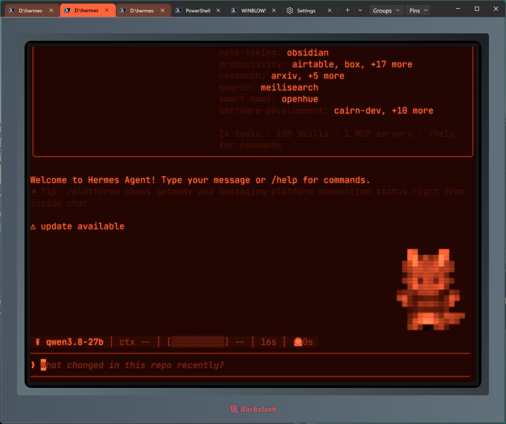
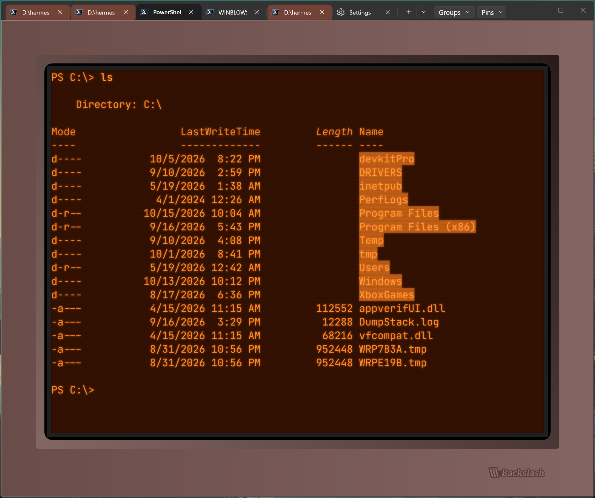
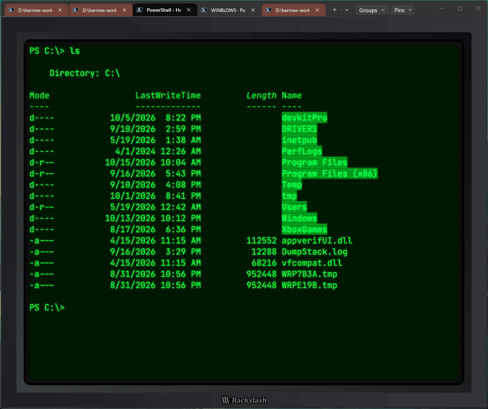
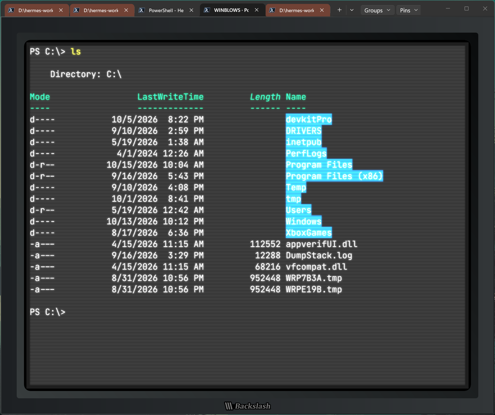
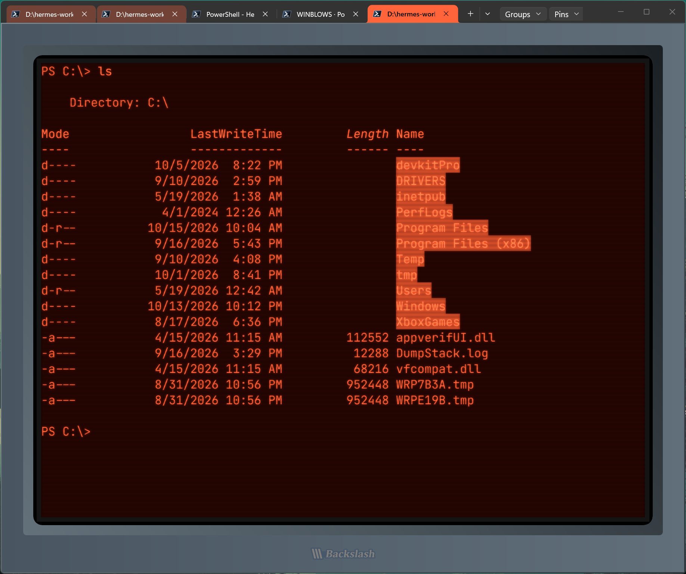
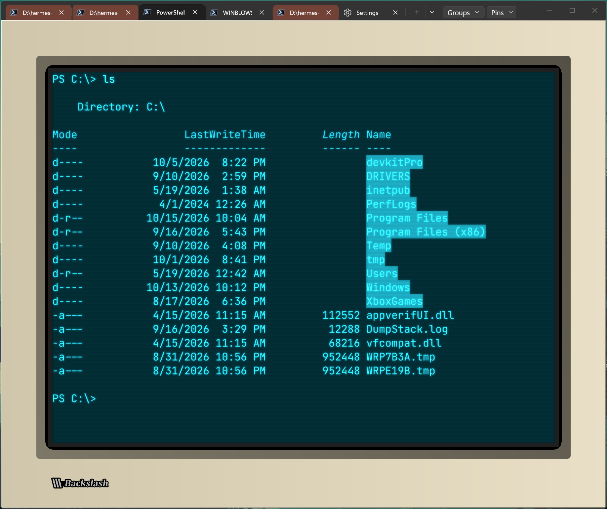
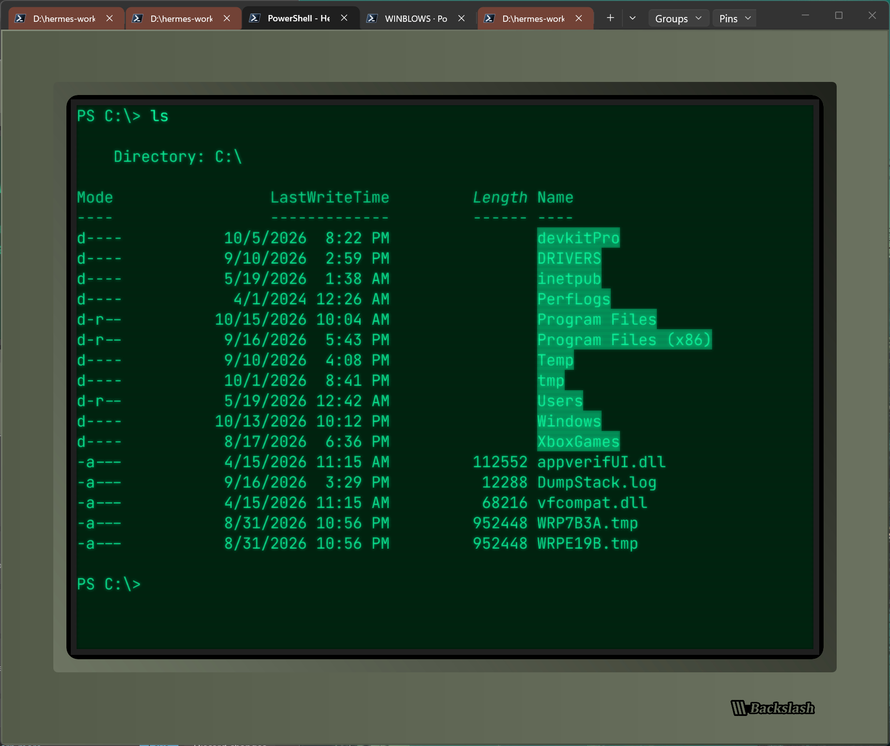
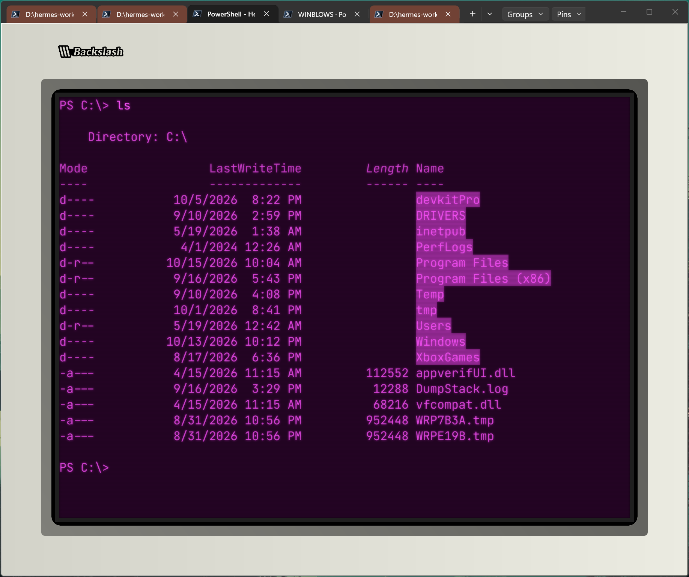

# Backslash Terminal

Backslash is a Windows-focused fork of Microsoft Windows Terminal, adding saved terminal layouts, pinned destinations, SSH profile tools and optional CRT styling to its tabs and panes. It builds on the existing C++/Windows codebase and upstream terminal capabilities, including split panes, profiles, color schemes and Sixel output.

**Windows is the current target. Linux and macOS support are TBD.** Current deliveries are unsigned, isolated **Backslash Dev portable builds**, not an installed production release. The source baseline is Windows Terminal **v1.25.2733.0**; see [upstream provenance](UPSTREAM-SOURCE.md).

## Implemented in development builds

- **Saved tab groups and startup:** save named tab/pane layouts with split ratios, profile references and focus; reopen them alongside existing tabs or select a group for initial startup. Manage groups in Settings > Startup, using profile-default folders or supported captured local folders. Groups launch fresh sessions; they do not preserve running processes or remote sessions. See [saved tab groups](docs/backslash/SAVED-TAB-GROUPS.md).
- **Pinned destinations:** a per-portable-copy Pins catalog remembers fixed destinations separately from groups. Compact shortcuts launch lazily when selected, with Open here, Move here, Gather and Unpin operations. Live PowerShell 7 folder reporting supports **Pin current folder**; **Add a folder...** provides manual entry. Local, WSL and SSH launch support has explicit launcher/path limits. See [pinned destinations](docs/backslash/PINNED-TABS-IMPLEMENTATION.md), [current checkpoint](docs/backslash/PINNED-STATUS.md) and [live folder metadata](docs/backslash/LIVE-CWD-AND-SESSION-METADATA.md).
- **CRT appearance:** saved per-profile glow, phosphor tint, scanline intensity, thickness and gap controls, with preview, inheritance and reset support. Rendering work includes opacity/tint corrections and suspension of hidden controls. See [CRT appearance](docs/backslash/CRT-APPEARANCE.md) and [rendering implementation and validation](docs/backslash/CRT-RENDERING-PLAN.md).
- **Retro bezel and SVG badges:** size and color/finish presets, fullscreen aperture centering, an opaque surround, six badge placements and independent extra filler. Solid, Outline and CurrentColor artwork are supported; CurrentColor adds independent Lettering and Backing colors or transparent None. Muted retro red and warm mustard extend the finishes. See [bezel design](docs/backslash/BEZEL-DESIGN.md), [SVG badges](docs/backslash/BEZEL-BADGE-IMPLEMENTATION.md), [badge colors](docs/backslash/CURRENTCOLOR-BADGE-CONTROLS.md) and [added finishes](docs/backslash/BEZEL-FINISH-EXTENSIONS.md).
- **SSH profiles, WSL and connection titles:** explicit SSH host scan/add/restore, stable profile identities, selectable remote shells and modern WSL distro discovery. Connection identity appears in tab and Ctrl+Tab titles by default, with an Appearance opt-out. See [SSH/WSL behavior](docs/backslash/SSH-PROFILES.md) and [connection titles](docs/backslash/CONNECTION-TITLES.md).
- **Portable isolation and curated defaults:** adjacent settings/state, separate Backslash local storage, disabled automatic upstream settings import and disabled external fragment discovery. Fresh defaults use an 80 x 28 grid, centered launch, 16-point font, filled-box cursor and hidden scrollbar; CRT effects and the bezel remain off until enabled. Existing explicit settings take precedence. See [portable implementation](docs/backslash/PORTABLE-IMPLEMENTATION.md) and [curated defaults](docs/backslash/CURATED-DEFAULTS.md).

The linked implementation records contain build, model, shader, composed-render and owned portable runtime evidence. Validation varies by feature: native interaction, accessibility, DPI/hardware-GPU coverage and real SSH/WSL checks remain incomplete. Some records describe earlier checkpoints; their artifact paths and test counts are historical evidence, not a claim that every check was rerun against the current checkout. Final branding, package identity, signing and release readiness remain outstanding.

## Planned and under investigation

- Richer SSH bookmarks and grouping, resumable remote sessions, and integrated file navigation/transfers.
- Palette copy/fill tools and an opt-in curated font catalog.
- Expanded inline graphics, local SSH command composition, completion and configurable shared history.
- Further CRT/material effects, optional keyboard sounds, terminal status bars and reorganized settings navigation.

These are design goals, not shipped features or a release schedule. The [roadmap](docs/backslash/ROADMAP.md) and [feature scope](docs/backslash/FEATURES.md) retain original planning text; use the implementation records above for delivered scope. See also the [file-transfer design](docs/backslash/FILE-TRANSFER-DESIGN.md), [SSH editor research](docs/backslash/SSH-LOCAL-EDITOR-RESEARCH.md) and [resumable-session design](docs/backslash/RESUMABLE-SESSIONS-DESIGN.md).

## Build and run

Use **PowerShell 7 on Windows** with an installed Visual Studio C++ toolchain, Windows SDK and the upstream packaging prerequisites. The recorded build configuration is **Release x64**. From the repository root:

```powershell
pwsh -NoProfile -File .\tools\backslash\Build.ps1 -Preflight
pwsh -NoProfile -File .\tools\backslash\Build.ps1
```

Preflight checks source and tool paths; the build restores dependencies and writes a unique run directory under `artifacts/build`. To assemble and check an isolated portable distribution, replace the build-run placeholder with the successful run's directory:

```powershell
pwsh -NoProfile -File .\tools\backslash\New-PortableDistribution.ps1 -BuildRun '.\artifacts\build\<successful-run-directory>'
pwsh -NoProfile -File .\tools\backslash\Test-PortableIsolation.ps1 -PortableDirectory '.\artifacts\portable\Backslash-Dev-<successful-run-directory>'
```

Launch `WindowsTerminal.exe` by its full path inside the generated portable directory, keeping `.portable` and the complete distribution together. The executable name is retained for compatibility. The unsigned MSIX build output is an intermediate payload with retained upstream package identity; use the portable distribution for development runs.

The [Windows build guide](tools/backslash/README.md) covers prerequisites, overrides and logs. The [portable guide](docs/backslash/PORTABLE-IMPLEMENTATION.md) explains assembly, isolation and limitations. The [project documentation index](docs/backslash/README.md) links detailed designs and validation records.

## Screenshots

#### Profile visual customization examples:

<div style="text-align: center;">
<br/><br/>
<br/><em>A Backslash terminal window running Hermes Agent, customized with bezel size and colors, scanline size and separation, and screen phosphor color.</em>
</div><br/><br/>


<br/>

|  |  |  |  |
|-----|-----|-----|-----| 
|  |  |   |    |

<br/><br/>

>**DEV NOTE**:  Save future screenshots in [`docs/images`](docs/images/README.md). That folder's guide covers suggested captures and removing credentials/private details. Images will be added here after they are supplied and reviewed.

<br/>

## Attribution and licensing

Backslash derives from [Microsoft Windows Terminal](https://github.com/microsoft/terminal), including its console and shared components. The source baseline and preparation history are recorded in [upstream provenance](UPSTREAM-SOURCE.md).

Original Microsoft attribution, the [MIT license](LICENSE), [third-party notices](NOTICE.md) and component licenses are retained. See also the [contributing guide](CONTRIBUTING.md) and [code of conduct](CODE_OF_CONDUCT.md).
