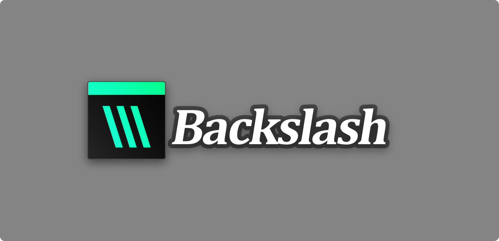
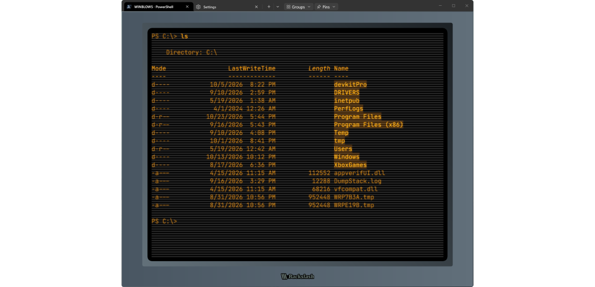
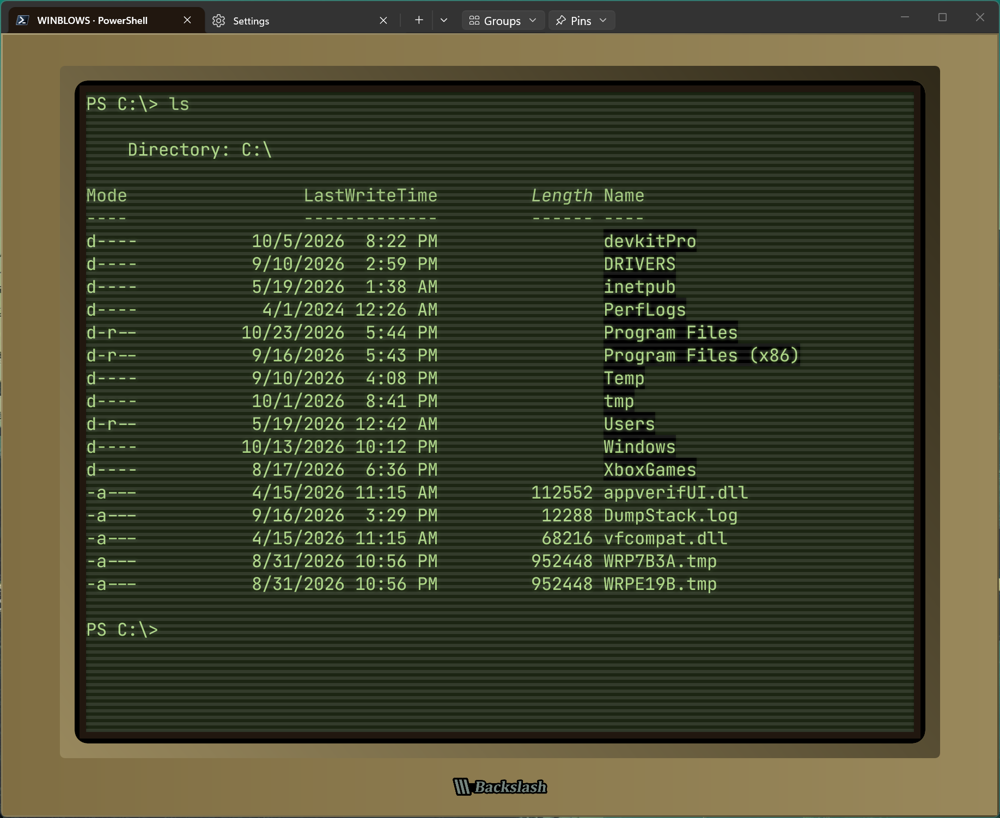
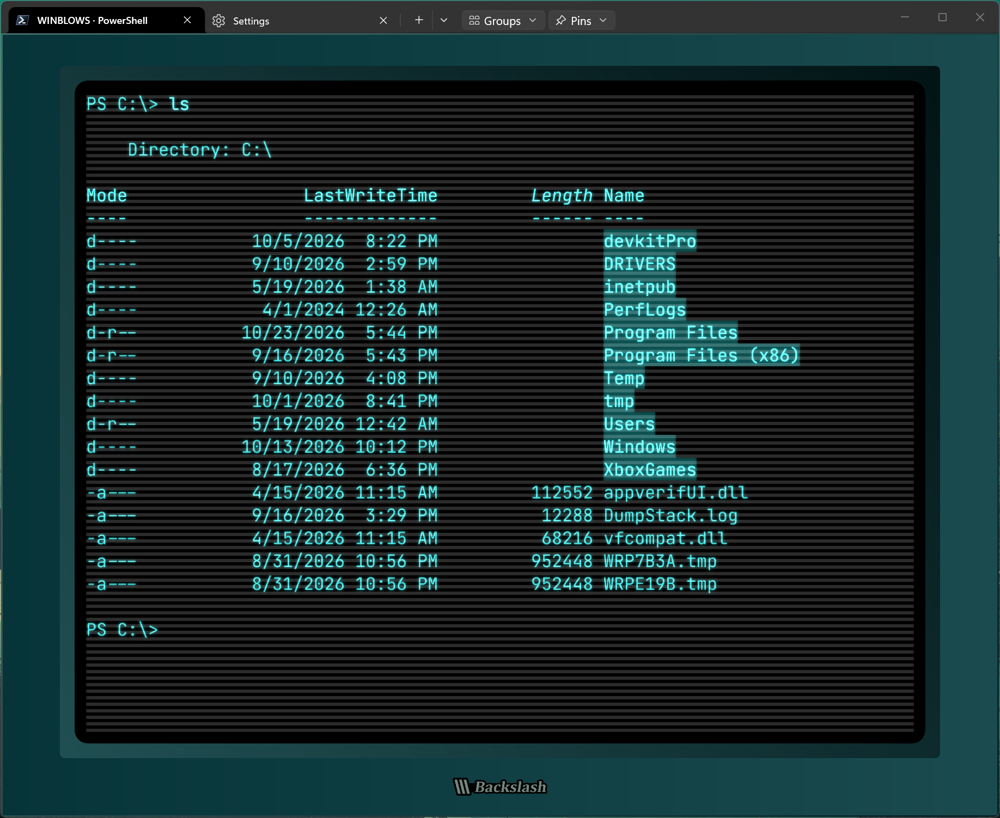
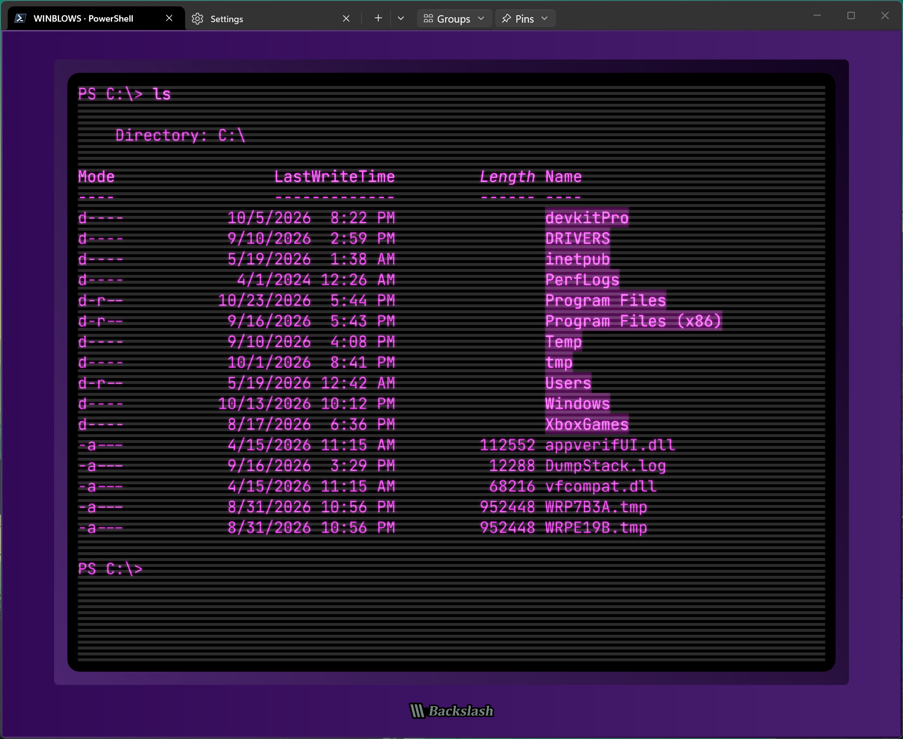
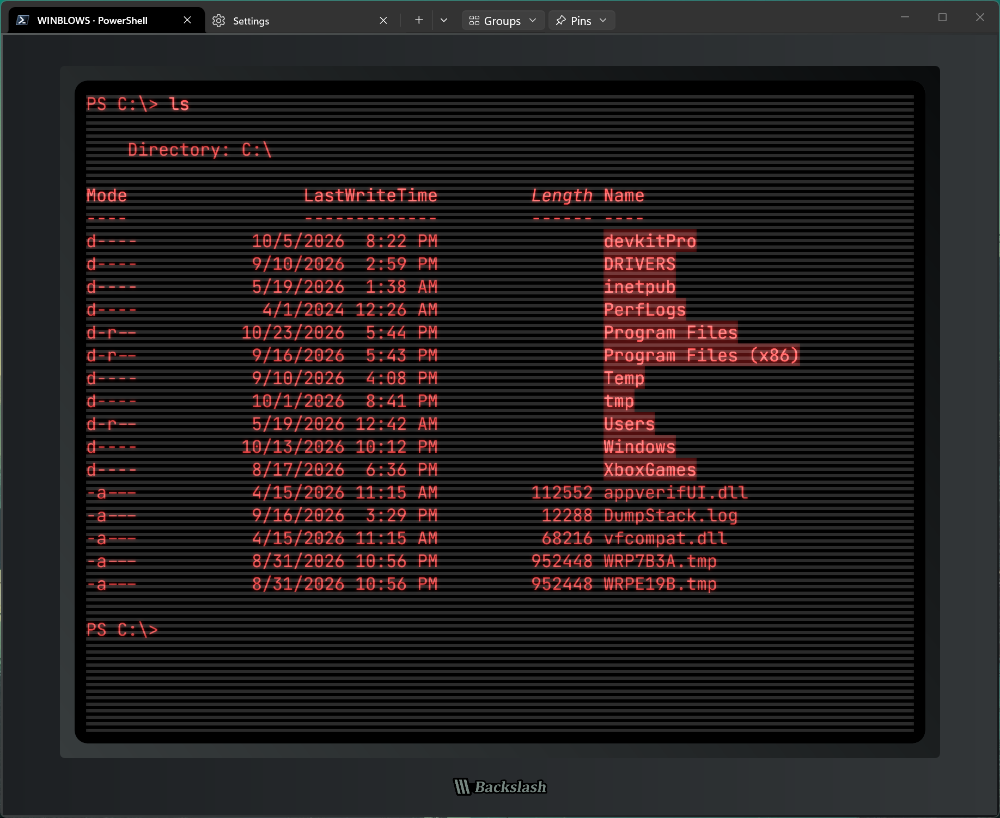
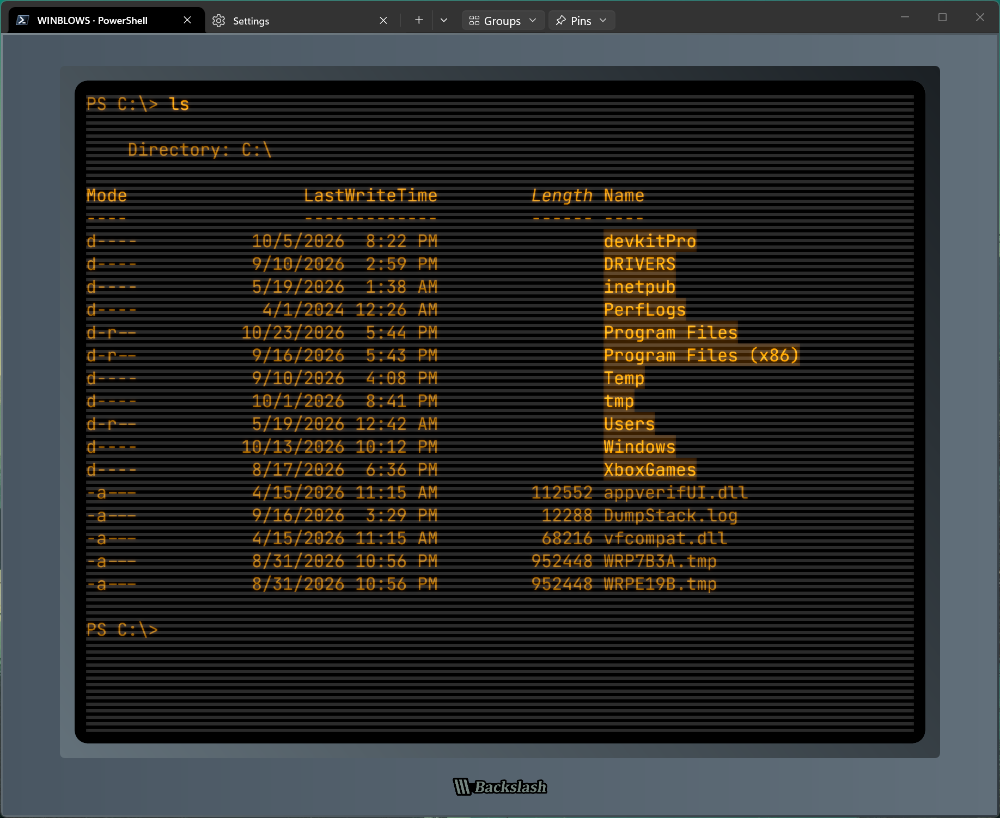
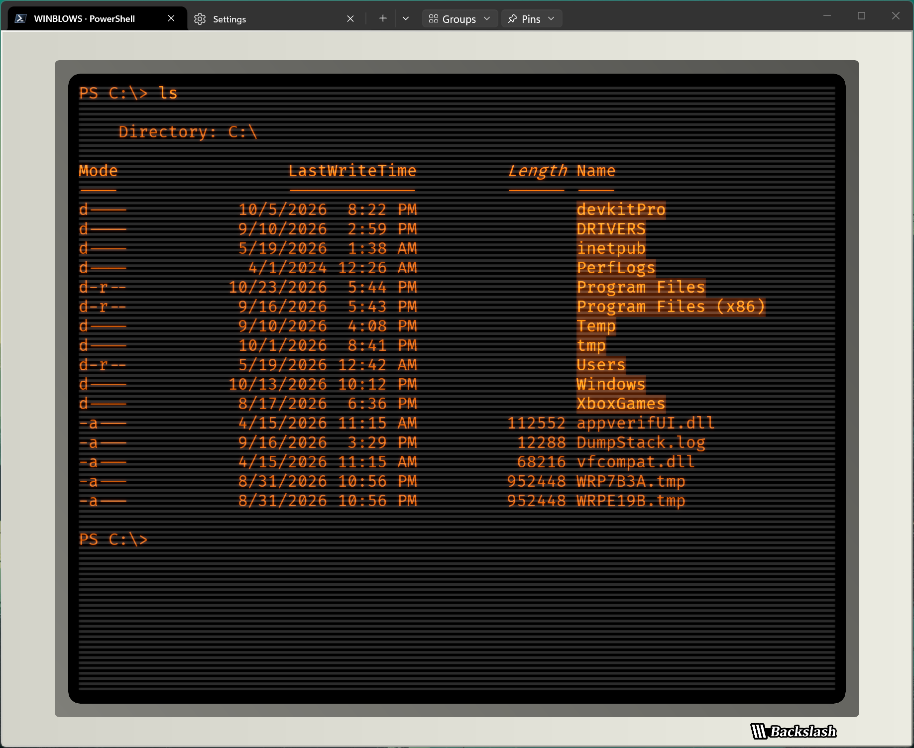
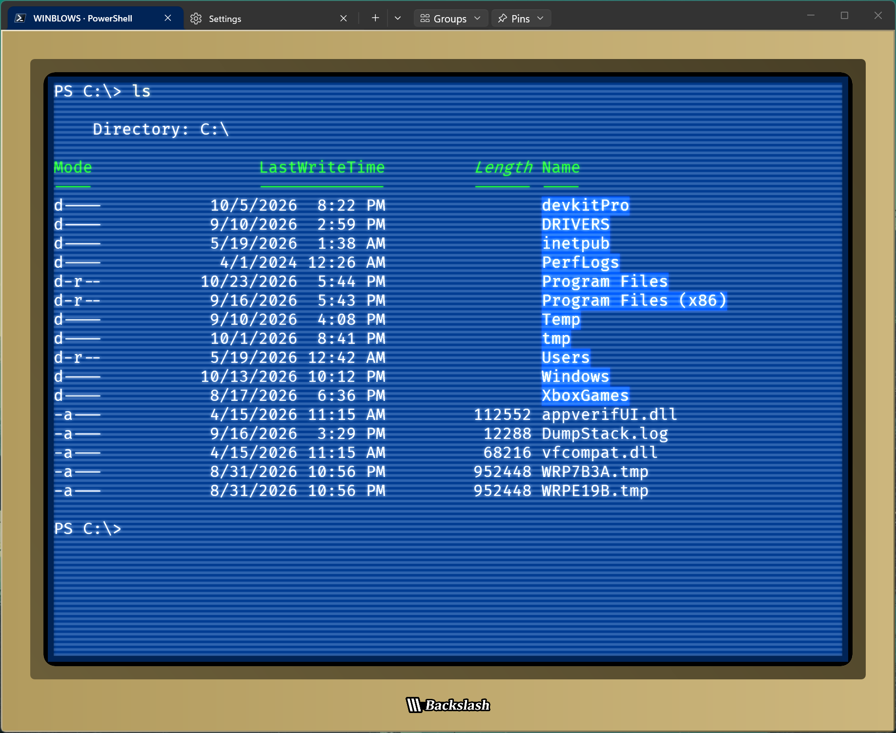
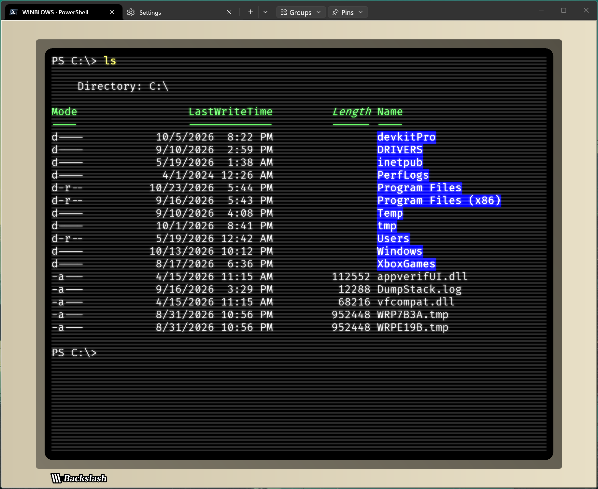

<br/>
<br/>

## Backslash Terminal

Backslash is a Windows fork of Microsoft Windows Terminal with saved terminal layouts, pinned destinations, SSH profile tools and optional CRT styling. It includes the upstream tabs, split panes, profiles, color schemes and Sixel support.

**Experimental, unsigned Windows x64 preview.** Linux and macOS builds are not available. Compatibility and accessibility testing is incomplete; the preview has a known intermittent blank or transparent Settings-pane issue.

## Download and run

1. Choose a Windows x64 portable ZIP from [Releases](https://github.com/nemo404PDX/backslash-terminal/releases) and read that version's feature notes and known issues. Source builds may contain features absent from a released ZIP.
2. Extract the complete ZIP into a writable folder. Keep `Backslash.exe`, `.portable` and the supporting files together.
3. Run `Backslash.exe`. Windows may show an unsigned-application warning; the preview is not signed.

Portable settings and state are stored in an adjacent `settings` folder. Back up that folder before updating and keep it when moving the application. A normal local folder works; a USB drive is optional. Backslash does not automatically import Windows Terminal settings. See the [portable guide](docs/backslash/PORTABLE-IMPLEMENTATION.md) for storage and build details.

## Features

- **Saved tab groups:** save named tab/pane layouts, split ratios, profile references and focus; reopen them or choose a group at startup. Groups start fresh sessions and do not preserve running processes. [Saved groups](docs/backslash/SAVED-TAB-GROUPS.md)
- **Pinned destinations:** keep fixed local, WSL and SSH destinations separate from saved groups. Supported PowerShell 7 sessions can report their current folder for pinning; manual folder entry is also available. [Pins and supported launchers](docs/backslash/PINNED-TABS-IMPLEMENTATION.md)
- **CRT and bezel appearance:** configure per-profile glow, phosphor tint, scanlines, bezel finishes, SVG badges and badge colors, with preview, inheritance and reset controls. Effects are off by default. [Appearance controls](docs/backslash/CRT-APPEARANCE.md)
- **Settings placement:** open Settings in a tab, beside a terminal or in a separate window. A split tab's close button closes its focused pane; the context menu also offers Close entire tab. [Settings placement](docs/backslash/SETTINGS-PLACEMENT.md)
- **SSH and WSL profiles:** explicitly scan and import selected SSH aliases, keep saved connections across restarts, and use local WSL distributions. SSH aliases require this computer's SSH configuration and authentication; keys and credentials are not bundled. [SSH import](docs/backslash/SSH-PORTABLE-IMPORT.md)
- **Experimental SFTP transfers:** browse local and remote folders and upload or download individual files using a saved SSH profile. Real-world reliability and complete user workflows are not yet verified. Requires noninteractive authentication and an already trusted host key. [Transfers and limitations](docs/backslash/TRANSFERS-FOUNDATION.md)

Feature availability depends on the downloaded version. Recursive transfers, remote replacement, resumable remote sessions and other transfer engines are not available. Broader theme, DPI, accessibility and real SSH/WSL compatibility testing is still needed. See the [feature scope](docs/backslash/FEATURES.md) and [roadmap](docs/backslash/ROADMAP.md).

## Build from source

Use PowerShell 7 on Windows with Visual Studio C++ tools, the Windows SDK and the upstream packaging prerequisites. Release x64 is the validated build configuration:

```powershell
pwsh -NoProfile -File .\backslash\tools\backslash\Build.ps1 -Preflight
pwsh -NoProfile -File .\backslash\tools\backslash\Build.ps1
```

The [Windows build guide](backslash/tools/backslash/README.md) covers prerequisites and portable assembly. The unsigned MSIX build output retains upstream package identity and is an intermediate payload; use the portable distribution for development runs. Source and solutions live in [backslash/](backslash/README.md); [documentation](docs/README.md) includes feature guides and contributor references.

## Screenshots

#### Profile visual customization examples:

<div style="text-align: center;">
<br/><br/>
<br/><em>A Backslash terminal window customized with bezel size and colors, scanline size and separation, and screen phosphor color.</em>
</div><br/><br/>


<br/>

|  |  |   |  |
|-----|-----|-----|----|
|  |  |  |  |

<br/><br/>

## Attribution and licensing

Backslash derives from [Microsoft Windows Terminal](https://github.com/microsoft/terminal), including its console and shared components. The source baseline and preparation history are recorded in [upstream provenance](docs/backslash/UPSTREAM-SOURCE.md).

Original Microsoft attribution, the [MIT license](LICENSE), [third-party notices](NOTICE.md) and component licenses are retained. See also the [contributing guide](.github/CONTRIBUTING.md) and [code of conduct](.github/CODE_OF_CONDUCT.md).
