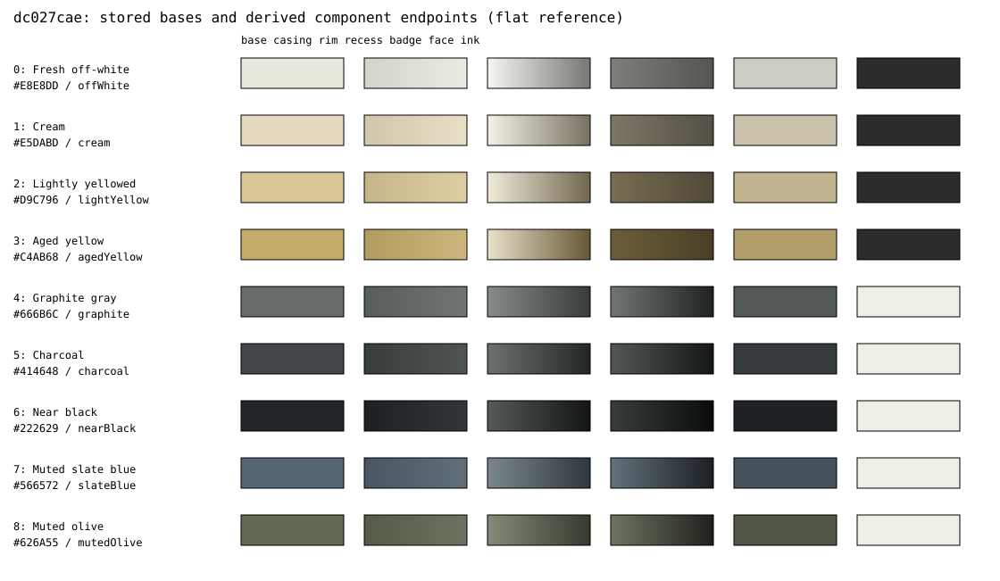

# Frozen bezel palette reference: dc027cae

Source commit **`dc027cae58b9414c4c0bdcb5790093fb7165ba8e`** ([immutable snapshot](https://github.com/nemo404PDX/backslash-terminal/tree/dc027cae58b9414c4c0bdcb5790093fb7165ba8e)). This is the same older source anchor as [the phosphor backup](PHOSPHOR-COLOR-REFERENCE-dc027cae.md), not a claim that every bezel variant received separate user visual acceptance. Existing values below are preserved independently of future code changes. No new palette is invented or implemented.

Authoritative literals and derived channel values: [bezel.json](color-reference/dc027cae/bezel.json), SHA256 **`B2380055CE1714CB05DBBDDCAD24482A6B4FC794ED7870C337FD0D3CCFCAC41E`**. Stored versus derived fields are labeled. All derived colors were evaluated by **the older C++ helpers**, including float32-to-byte light-rim truncation. Keep this version immutable; create a new reference version when adding/changing a palette.

The SVG is a flat color/gradient reference, not a rendered monitor or a native visual acceptance result. Its endpoints are exact; screen appearance depends on display/color management and XAML rendering.

## Stored bases and stable names

Source: `src/cascadia/inc/BezelBadgeMaterial.h::BezelPaletteArgb`, `Profile.idl::RetroBezelColor`, `TerminalSettingsSerializationHelpers.h` enum mapping, and English editor resources. Packed constants are **0xAARRGGBB**; every stored alpha is FF=255. Default is **OffWhite/offWhite**. Indices and serialized tokens are compatibility data.

| Index | English label | Enum / JSON token | Base RGB | RGB8 | Material branch |
| --- | --- | --- | --- | --- | --- |
| 0 | Fresh off-white | `OffWhite` / `offWhite` | `#E8E8DD` | 232, 232, 221 | light plastic |
| 1 | Cream | `Cream` / `cream` | `#E5DABD` | 229, 218, 189 | light plastic |
| 2 | Lightly yellowed | `LightYellow` / `lightYellow` | `#D9C796` | 217, 199, 150 | light plastic |
| 3 | Aged yellow | `AgedYellow` / `agedYellow` | `#C4AB68` | 196, 171, 104 | light plastic |
| 4 | Graphite gray | `Graphite` / `graphite` | `#666B6C` | 102, 107, 108 | dark |
| 5 | Charcoal | `Charcoal` / `charcoal` | `#414648` | 65, 70, 72 | dark |
| 6 | Near black | `NearBlack` / `nearBlack` | `#222629` | 34, 38, 41 | dark |
| 7 | Muted slate blue | `SlateBlue` / `slateBlue` | `#566572` | 86, 101, 114 | dark |
| 8 | Muted olive | `MutedOlive` / `mutedOlive` | `#626A55` | 98, 106, 85 | dark |

`BezelPaletteCount=9`; the original four light plastics retain indices 0..3. Dark classification is `4 <= index < count`. Out-of-range base lookup falls back to index 0. All derived brushes force opaque alpha rather than borrowing the terminal's background opacity.

## Exact gradients and component mapping

Every brush below has exactly two stops, offsets **0 and 1**. Casing direction is `(0,0.5)->(1,0.5)` (left to right); outer rim and badge seam use `(0,0)->(1,1)`; recess uses `(0,1)->(1,0)` (bottom-left to top-right). `RetroBezel.h::_gradient` supplies these points and colors; it does not add intermediate stops or animate them.

| Index | Casing stop 0 -> 1 | Rim stop 0 -> 1 | Recess stop 0 -> 1 |
| --- | --- | --- | --- |
| 0 | `#D3D3C9` -> `#EBEBE1` | `#F6F6F3` -> `#787872` | `#7F7F79` -> `#555551` |
| 1 | `#D0C6AB` -> `#E8DFC6` | `#F5F2E7` -> `#777162` | `#7D7767` -> `#545045` |
| 2 | `#C5B588` -> `#DECEA4` | `#F1EBDA` -> `#70674E` | `#776D52` -> `#504937` |
| 3 | `#B29B5E` -> `#CCB67D` | `#EAE1CA` -> `#655836` | `#6B5E39` -> `#483F26` |
| 4 | `#575C5C` -> `#6F7475` | `#878C8A` -> `#383A3B` | `#707675` -> `#202222` |
| 5 | `#373C3D` -> `#4E5354` | `#6C7170` -> `#232627` | `#515757` -> `#141617` |
| 6 | `#1D2023` -> `#323638` | `#555959` -> `#121416` | `#373C3D` -> `#0A0C0D` |
| 7 | `#495662` -> `#616F7A` | `#7B878E` -> `#2F373E` | `#63717A` -> `#1B2024` |
| 8 | `#545B49` -> `#6B7360` | `#848B79` -> `#353A2E` | `#6D7562` -> `#1F211B` |

`_shell.Fill` consumes casing left-shadow/right-highlight. `_rim.BorderBrush` consumes rim highlight/shadow. `_aperture.Fill` intentionally consumes **recess.highlight first, recess.shadow second**, so the softer lower/left edge leads into the darker upper/right shadow. Field names alone can hide that ordering; the table records actual brush order.

| Index | Badge face | Upper/left seam | Lower/right seam | Lettering |
| --- | --- | --- | --- | --- |
| 0 | `#CDCDC5` | `#5C5C58` | `#868680` | `#2A2D2B` |
| 1 | `#CBC2AC` | `#5B574B` | `#847E6D` | `#2A2D2B` |
| 2 | `#C1B38D` | `#564F3C` | `#7D7357` | `#2A2D2B` |
| 3 | `#B19E69` | `#4E4429` | `#71633C` | `#2A2D2B` |
| 4 | `#535859` | `#282A2B` | `#6C7171` | `#EEEFE5` |
| 5 | `#363B3D` | `#1A1C1C` | `#4B5151` | `#EEEFE5` |
| 6 | `#1E2225` | `#0D0F10` | `#303436` | `#EEEFE5` |
| 7 | `#46535D` | `#22282D` | `#5E6C76` | `#EEEFE5` |
| 8 | `#505747` | `#272A22` | `#68705D` | `#EEEFE5` |

The badge uses a solid face and solid `BACKSLASH` lettering; its 1-DIP border uses the two seam colors. Lettering is stored `#2A2D2B` on light palettes and `#EEEFE5` on dark palettes. Geometry/style: height 22 DIP, seam 1 DIP, font size 11, weight 700, character spacing 160; these affect presentation, not the palette RGB.

## Stored blend targets and derived calculations

`BlendBezelRgb(base,tint,p)` works on each encoded byte channel using integer arithmetic:

`channel = floor((baseChannel*(100-p) + tintChannel*p) / 100)`; alpha is set to 255.

These percentages are **baked RGB mixtures**, not runtime brush opacity or a physical lighting simulation. No sRGB-to-linear conversion is performed by this helper. Runtime XAML brush interpolation is left to the framework; the literal endpoints here remain authoritative.

| Role | Light plastics (0..3) | Dark finishes (4..8) |
| --- | --- | --- |
| Casing left shadow | base + 9% black | base + 14% black |
| Casing right highlight | base + 14% white | base + 10% `#C5CCC7` |
| Rim stop 0 | float32 mix toward 255 by 0.65 | base + 27% `#E2E6DD` |
| Rim stop 1 | float32 mix toward 0 by 0.48 | base + 45% black |
| Recess shadow | base + 63% black | base + 68% black |
| Recess highlight | base + 45% black | base + 16% `#A9B1A9` |
| Badge face | base + 22% `#707070` | base + 22% `#111517` |
| Badge seam stop 0 | base + 60% black | base + 60% black |
| Badge seam stop 1 | base + 42% black | base + 12% `#9AA29A` |

The two light-rim stops use `uint8_t(float32(c + (target-c)*amount))`, truncating toward zero, rather than the integer-percent helper. The C++ probe preserves that distinction; do not replace frozen bytes with rounded screenshot estimates.

## Inner gap, backing and opacity

`RetroBezelGeometry.h::BezelSurroundArgb` is **0xFF000000 / #000000**, alpha 255. `_surround` is a hollow black border with **Opacity=1** and **Background=null**, so no plastic or black backing is painted behind the rectangular terminal screen. It covers non-screen pixels including the safety gutter. Inner clearance is 6 DIP, recess band 18 DIP, outer rim 2 DIP; casing widths are 40/56/72 DIP. Outer radius is 0; recess outer/inner radii request 6/16 DIP and clamp to layout size. Badge adds a 28-DIP chin. Layout/antialiasing can create boundary coverage; opaque stored materials do not imply every edge pixel has full coverage.

Terminal `opacity`, acrylic, phosphor tint and ANSI palettes do not alter these bezel material constants. Ordinary source-over composition is `Cout = a*Csource + (1-a)*Cbehind` in the renderer/framework's working space; these brush interiors have a=1, while antialiased edges can have partial coverage. This reference does not assume a particular monitor gamma/HDR transform. The bezel is separate XAML content outside the CRT GPU pass.

Defaults: bezel disabled; size `medium`; color `offWhite`; badge `bottom`; fullscreen centering enabled. Keys are `experimental.retroBezelEnabled`, `experimental.retroBezelSize`, `experimental.retroBezelColor`, `experimental.retroBezelBadge`, `experimental.retroBezelCenterFullscreen`. They follow existing profile inheritance/local override/reset behavior.

## Adding another palette later without changing these nine

1. Choose an original descriptive name and exact RGB. Append an explicit enum index after 8 in `Profile.idl`; never renumber/reuse indices 0..8 or change existing JSON tokens. Append the base in `BezelPaletteArgb`, update its count, and add a stable token in `TerminalSettingsSerializationHelpers.h`. `EnumMappings.cpp` derives its map from that enum mapping.
2. Add the English resource label used by `Appearances.cpp`'s bindable enum control. Keep the existing OffWhite default. Do not change phosphor or ANSI settings when selecting a casing finish.
3. Decide the new material branch explicitly. Current `IsDarkBezelPalette` treats every appended in-range index >=4 as dark; a new light finish requires deliberate classification logic while preserving all old outputs. Use the shared blend helpers or a separately named new rule; do not retune existing shared percentages to make one new color work.
4. Add serialization/inheritance/reset/adapter tests for the new token, and compare all nine old base/component colors against this JSON and source snapshot. Check badge contrast, inner gap and opaque bezel at terminal opacity 100/99/50/0, plus native preview/Save/Cancel/DPI. Keep a separate versioned reference for the enlarged catalog; this file remains the old backup.

This is a procedure only. No palette entry, renderer setting or running installation is changed by this documentation slice.
