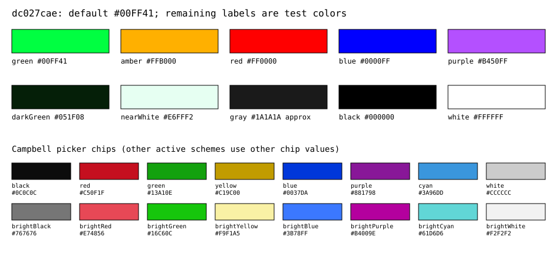

# Frozen phosphor color reference: dc027cae

This is a literal backup, **not a live table generated from current implementation**. Source commit: **`dc027cae58b9414c4c0bdcb5790093fb7165ba8e`** ([GitHub snapshot](https://github.com/nemo404PDX/backslash-terminal/tree/dc027cae58b9414c4c0bdcb5790093fb7165ba8e)). The documented user-accepted opacity/tint build is **13ebff74**, whose shader source matches this commit. The newer complaint does not identify its two build paths, so this is the supported older baseline choice, not an assertion about the unseen comparison. The pre-correction commit `bfd6c420a12532e777dfc76fba7081a639e17c7c` is distinguished below.

Authoritative frozen values: [phosphor.json](color-reference/dc027cae/phosphor.json), SHA256 **`D5BC2207E00FD99A22879DE581162E81733EDCE64B728D15FF8989ED8053AE76`**. It includes all 16 inbox ANSI schemes and 19 exact source/blob hashes. Preserve this file; add a new versioned reference for future colors rather than regenerating it from HEAD. [Bezel reference](BEZEL-COLOR-REFERENCE-dc027cae.md) is separate.

## Default and formats

The only fixed phosphor default is **`#00FF41`**, sRGB **R=0, G=255, B=65**, A=255. `Core::Color` fields are `(R,G,B,A)=(0,255,65,255)`; XAML `Color` positional order is `(A,R,G,B)`. Win32 COLORREF uses low-byte red: **`0x0041FF00`**; renderer `common.h` stores opaque packed ABGR **`0xFF41FF00`**. These are the same color, not different presets. Backend upload extracts low-byte red, next green and next blue, divides by 255, and places **tint intensity**, not color opacity, in the fourth shader constant.

| Setting | Frozen default | Units / behavior |
| --- | --- | --- |
| `experimental.retroTerminalEffect` | `false` | Built-in CRT gate; custom shader retains precedence |
| `experimental.retroTerminalTintColor` | `#00FF41` | sRGB RGB; independent of terminal ANSI roles |
| `experimental.retroTerminalTintIntensity` | `0.0` | 0..1; UI 0..100%; zero is exact bypass |
| `experimental.retroTerminalGlowIntensity` | `0.3` | 0..1 |
| `experimental.retroTerminalScanlineIntensity` | `0.5` | 0..1 |
| `experimental.retroTerminalScanlineThickness` | `1.0` | DIP; bounded 0.5..8 |
| `experimental.retroTerminalScanlineGap` | `1.0` | DIP; bounded 0..16 |

Model values are inherited per appearance, may differ in `profiles.defaults`, individual profiles and `unfocusedAppearance`, and reset/null clears a local override. Tint values use the same JSON keys above, local-copy and inheritance macros. A starting profile or new portable folder is not a color migration. Settings `opacity` is a percentage; renderer/control alpha is 0..1. It is a separate setting, not the tint slider.

## Names and picker chips

**There is no named green/amber/blue/purple phosphor preset catalog in this baseline.** The phosphor control is the shared `NullableColorPicker`, bound to `Appearance.CurrentColorScheme`. Its 16 shortcut chips are `ColorEntryAt(0..15)` from the active ANSI scheme. Choosing a different effective scheme/profile can therefore change those chips without changing the phosphor default or shader. This is source behavior, not a finding that the user's scheme changed.

The following names are historical **test/analysis labels**, retained to reproduce prior checks. They are not claimed to be user-selectable preset names:

| Test label | Literal RGB8 / normalized input | Hex | Full-white linear luminance scale |
| --- | --- | --- | --- |
| green | 0, 255, 65 | `#00FF41` | 0.719016539 |
| amber | 255, 176, 0 | `#FFB000` | 0.523106681 |
| red | 255, 0, 0 | `#FF0000` | 0.212600000 |
| blue | 0, 0, 255 | `#0000FF` | 0.072200000 |
| purple | 180, 80, 255 | `#B450FF` | 0.226606199 |
| darkGreen | 5, 31, 8 | `#051F08` | 0.010297696 |
| nearWhite | 230, 255, 242 | `#E6FFF2` | 0.947537991 |
| gray | normalized (0.1, 0.1, 0.1), not integer RGB8 | `#1A1A1A` nearest display only | 0.010022826 |
| black | 0, 0, 0 | `#000000` | 1.000000000 (black fallback) |
| white | 255, 255, 255 | `#FFFFFF` | 1.000000000 |

The gray fixture's exact channel is 0.1 (25.5 on a 255 scale). `#1A1A1A` is its nearest illustrative 8-bit swatch, not an exact replacement for that float fixture. Other listed RGB8 endpoints are exact.

The default Campbell chip order/values are frozen here; all other inbox scheme literals remain in the JSON:

| Index | Role | RGB hex |
| --- | --- | --- |
| 0 | black | `#0C0C0C` |
| 1 | red | `#C50F1F` |
| 2 | green | `#13A10E` |
| 3 | yellow | `#C19C00` |
| 4 | blue | `#0037DA` |
| 5 | purple | `#881798` |
| 6 | cyan | `#3A96DD` |
| 7 | white | `#CCCCCC` |
| 8 | brightBlack | `#767676` |
| 9 | brightRed | `#E74856` |
| 10 | brightGreen | `#16C60C` |
| 11 | brightYellow | `#F9F1A5` |
| 12 | brightBlue | `#3B78FF` |
| 13 | brightPurple | `#B4009E` |
| 14 | brightCyan | `#61D6D6` |
| 15 | brightWhite | `#F2F2F2` |

Campbell roles: foreground `#CCCCCC`, background `#0C0C0C`, cursor `#FFFFFF`. Do not confuse an ANSI chip named green with the independent phosphor default `#00FF41`.

## Frozen visible-output calculation

For encoded sRGB channel `c`, linearize using `c/12.92` below 0.04045, otherwise `((c+0.055)/1.055)^2.4`. The inverse uses `12.92*c` below 0.0031308, otherwise `1.055*c^(1/2.4)-0.055`. The HLSL uses `step` at the thresholds; the branches agree at the crossover to normal shader precision.

1. Glow adds a 13x13 Gaussian sample sum with sigma `2*DPI-scale`, scaled by glow strength, to the full float4. Existing scanlines then multiply that float4 by `1 - darkBandCoverage*scanlineStrength`. These legacy steps can change alpha; tint preserves its **post-CRT input alpha**, not a promise that the entire pipeline never changes alpha.
2. At tint strength zero, bypass all tint conversions/clipping exactly. Otherwise, for positive alpha `a`, unpremultiply `rgb/a`, saturate and linearize. For zero alpha return transparent black.
3. Compute `Y = saturate(0.2126*R + 0.7152*G + 0.0722*B)`. Linearize the selected phosphor into `P`. Endpoint `E=P`, except exact black uses `(1,1,1)` to avoid blanking the terminal.
4. Full tint is `Y*E`. Partial tint is `lerp(originalLinear, saturate(Y*E), strength)`. Convert the saturated result back to sRGB, premultiply by the original post-CRT `a`, and preserve `a`.

White therefore maps to the selected color at full strength independently of glyph coverage/background-opacity transitions. With nonblack endpoint luminance `L(P)`, full-white luminance scales by `L(P)`; at partial strength `s`, scale is `(1-s)+s*L(P)`. Dark/saturated choices can be substantially dimmer; this is the accepted hue-retaining contract. Selected white and exact black fallback yield grayscale. Full tint removes ANSI hue distinctions.

The earlier **bfd6c42** shader used a luminance-preserving **black -> phosphor -> white** ramp, so white stayed white. For `Y<=L(P)` its first branch was `P*Y/max(L(P),1e-6)`; otherwise it interpolated `P -> (1,1,1)` by `(Y-L(P))/max(1-L(P),1e-6)`. It also divided input RGB by `max(a,1e-6)`. Commit dc027cae includes the bounded 16-line shader correction replacing that behavior; it predates user acceptance of 13ebff74. Do not restore the old white endpoint to fix an unrelated later complaint.

The pass affects renderer pixels (text, cell backgrounds, cursor/selection and inline images). Separate XAML window/profile background images, wallpaper/acrylic backdrop and bezel/chrome are outside it. Identical shader output can composite differently against a different backdrop or opacity. This reference specifies math and literal colors, not native screen calibration, HDR or physical phosphor accuracy.

## Source and change procedure

Frozen source paths and exact git-blob/SHA256 values are in the JSON: `custom_shader_ps.hlsl`, `BackendD3D.cpp`, renderer `common.h`, model `MTSMSettings.h`/`AppearanceConfig.cpp`, adapter-facing `ControlProperties.h`, `Appearances.cpp/.xaml`, `NullableColorPicker.cpp/.xaml`, and model `defaults.json`. Immutable commit links above preserve the original code independently of HEAD.

Before adding a named phosphor catalog, decide whether entries are dedicated phosphor colors or shortcuts from an ANSI scheme. Preserve the default RGB and existing serialized keys, never reinterpret old values, append new named entries with exact RGB/labels, and keep the current picker behavior compatible. Add endpoint/roundtrip/inheritance/opacity regressions against this frozen reference. A new color catalog would be a separate implementation slice; none is added here.
